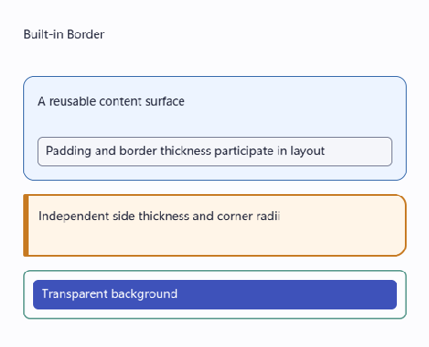

# Border 容器

`Border` 是内置单子节点容器。它按背景、边框、子内容的顺序绘制，不添加主题卡片外观。将多个控件放进 StackPanel、Grid 或其他容器后，可以作为一个子节点放入 Border。

```xml
<Border Background="#edf4ff" BorderBrush="#3569ab"
        BorderThickness="1,2,3,4" CornerRadius="4,8,12,16" Padding="12">
  <StackPanel Spacing="8">
    <TextBlock Text="Account"/>
    <TextBox Text="Name"/>
  </StackPanel>
</Border>
```

| 属性 | 类型和顺序 | 默认值 |
|---|---|---|
| Background | Color：`#RRGGBB` 或 `#AARRGGBB` | 透明 |
| BorderBrush | Color：当前为实色 | 黑色 |
| BorderThickness | Thickness：左、上、右、下；支持 1、2、4 项 | 0 |
| CornerRadius | CornerRadius：左上、右上、右下、左下；支持 1 或 4 项 | 0 |
| Padding | 0..64 有限浮点逻辑像素，四边相同 | 0 |

厚度和圆角使用有限、非负的浮点逻辑像素，每项最大 4096。布局保留浮点边界，绘制和设备像素命中时统一取整。边框厚度和 Padding 都参与内容尺寸，圆角不改变测量。大圆角按边长等比收缩；厚度超过尺寸时不产生负的内部区域。背景填充内部区域，边框填充环形区域，透明边缘使用相同覆盖率命令送入 CPU 和 D3D11。圆角不隐式裁剪子树。

四项外观属性支持 OneWay/OneTime 绑定、统一属性读写和清除、值来源、基础值和动画值层；无效类型或几何值保留原值。Fleck 可用 `Border.Background` 属性元素声明画刷。参见 [绘图示例](../snippets/fleck/drawing.fleck)、[属性动画](animation.md)和 [Visibility](visibility.md)。

```csharp
var border = new Sunfleck.Elements.Border(app) {
    Background = new Color(0xffedf4ff),
    BorderBrush = new Color(0xff3569ab),
    BorderThickness = new Thickness(1, 2, 3, 4),
    CornerRadius = new CornerRadius(4, 8, 12, 16),
    Padding = 12
};
border.Node.Append(content);
```

C 使用 `ui_Border_create`、`ui_Border_node` 和生成的属性描述，例如 `ui_Border_BackgroundProperty`；通过 `ui_node_set_property` 传递 `UI_VALUE_COLOR`、`UI_VALUE_THICKNESS`、`UI_VALUE_CORNER_RADIUS`。C++ 使用 `sunfleck::elements::Border`、对应类型描述以及 `Node::setPropertyValue`。三语言接口和编辑器补全/F12 均由原生 schema 生成。

XML、生成 C/C++ 页面和编译资源保留外观属性及显式默认值。第二个直接子节点、非法颜色或厚度导致加载失败，刷新保持原有效页面。旧 SDK 不认识 Border，独立项目需要同时更新原生库、头文件/托管库、编译器与语言服务。

[完整示例](../snippets/fleck/border.fleck) · [通用布局属性](layout-properties.md) · [统一属性系统](property-system.md)


