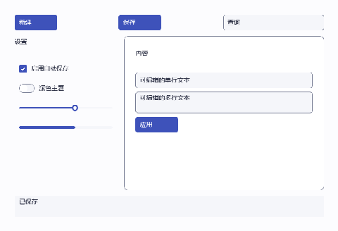
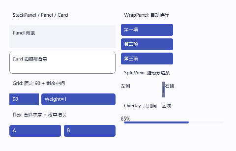
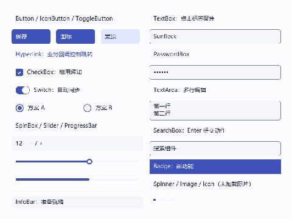
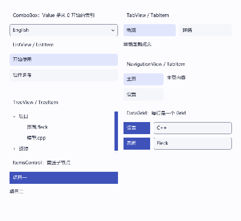
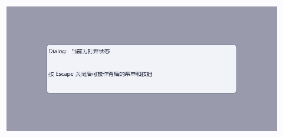
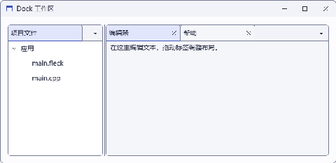

# Fleck 组件与效果预览

Fleck 是 Sunfleck 的 XML 页面格式。它描述一棵由框架保留和绘制的节点树；C、C++ 或 C# 负责模型、命令和生命周期。本文按用途列出当前实现的组件、常用属性、子节点规则和一个可以直接运行的页面示例。

## 最小页面

每个 Fleck 页面必须以 `Window` 为根，并使用 `urn:sunfleck:v1` 命名空间：

```xml
<Window xmlns="urn:sunfleck:v1" Title="组件预览" Width="720" Height="480">
  <StackPanel Spacing="12" Padding="20">
    <TextBlock Text="Fleck 组件预览"/>
    <Button Id="save" Content="保存"/>
  </StackPanel>
</Window>
```

打开窗口后，Sunfleck 会测量、排列、绘制和命中测试这棵树。`Id` 用于应用代码查找节点；它不是 HTML 的 DOM id，也不会跨页面全局唯一。

所有视觉节点支持可继承的 `FontFamily`、`FontSize`、`FontWeight`、`FontStyle` 和 `FontStretch`，用法与当前平台边界见 [字体与文字服务](fonts.md)。

文字外观提供 `Foreground`、`TextAlignment`、`TextWrapping`、`TextTrimming`、`LineHeight`、`TextDecorations` 和 `FlowDirection`；Windows 排版和编辑共用 DirectWrite。参见 [排版示例](../snippets/fleck/text-layout.fleck) 及字体文档中的继承与控件限制。

`TextBlock` 可包含 `Run` 和 `Span`：`Run.Text` 是可绑定文字，`Span` 为后代提供继承字体与前景色。它们是行内内容，不形成单独的布局槽位。参见 [行内示例](../snippets/fleck/inlines.fleck)；属性元素与完整 WPF Inlines 语法仍未实现。

## 效果预览

下面的页面把常见布局、文本、输入和反馈组件放在同一个窗口中。它可以作为检查主题、间距、绑定和键盘焦点的起始页面：



本文的预览图由 Windows 上的 Sunfleck 原生软件渲染器直接生成，使用 Radix 浅色主题。它们是实际控件的静态截图；其他主题、DPI 和平台字体会改变外观。下方源码可在本地预览器中运行，体验输入、选择和滚动。

<!-- source: docs/snippets/fleck/components.fleck -->

运行后可以看到顶部工具栏、左侧设置列、中间卡片、底部状态条。拖动滑块只改变滑块自身的数值；进度条在这个静态示例中保持 60。输入控件支持编辑，复选框和开关支持切换；“新建”“保存”“应用”尚未绑定业务动作。需要联动时，在应用中注册回调或绑定模型。

从仓库根目录，在 Visual Studio x64 开发者 PowerShell 中运行：

```powershell
cmake --preset debug
cmake --build --preset debug --target fleck_preview fleckc
./out/debug/fleck_preview.exe --renderer=software docs/snippets/fleck/components.fleck
./out/debug/fleckc.exe --format binary docs/snippets/fleck/components.fleck out/components.flkb
```

其他示例只需替换最后的 `.fleck` 路径。预览器加载不带业务绑定的页面；绑定示例需要随 C/C++/C# 应用一起运行。预览器默认主题可能不同于截图，应用可调用 `ui_app_set_builtin_theme(app, UI_BUILTIN_RADIX, 0, 0)` 选择同款主题。

这个可运行的页面源码是 [`docs/snippets/fleck/components.fleck`](../snippets/fleck/components.fleck)。构建文档时会直接读取该文件生成上面的代码块，源码与说明不会各自漂移。使用 `fleckc --format binary` 可以把它编译成 `.flkb`；接入 C、C++ 或 C# 后，再为按钮和输入控件添加模型绑定即可。

## 布局组件

| 组件 | 用途 | 常用属性 | 子节点限制 |
| --- | --- | --- | --- |
| `StackPanel` | 按指定方向排列 | `Orientation`、`Spacing`、`Padding` | 普通控件 |
| `Flex` | 按可伸缩空间排列内容 | `Spacing`、`Padding`、`Weight` | 任意普通控件 |
| `Grid` | 二维轨道布局 | `RowDefinitions`、`ColumnDefinitions` | 子项用 `Grid.Row`、`Grid.Column` 定位，用 `Grid.RowSpan`、`Grid.ColumnSpan` 跨轨道 |
| `WrapPanel` | 空间不足时自动换行 | `Spacing`、`Padding` | 任意普通控件 |
| `DockPanel` | 将子节点停靠到四边 | `Spacing`、`Padding`；子节点使用 `Dock` | `Left`、`Top`、`Right`、`Bottom` |
| `ScrollView` | 双向滚动 | `HorizontalScrollBarVisibility`、`VerticalScrollBarVisibility` | 可以包含多个普通子节点 |
| `Panel` | 普通容器和背景面板 | `Padding` | 任意普通控件 |
| `Border` | 背景画刷和独立圆角边框 | `Background`、`BorderBrush`、`BorderThickness`、`CornerRadius`、`Padding` | 零或一个普通子节点；详见 [Border](border.md) |
| `Card` | 带卡片背景的容器 | `Padding` | 任意普通控件 |
| `Overlay` | 将内容叠放在同一位置 | `Padding` | 任意普通控件 |
| `SplitView` | 两个区域的可调整分栏 | `Value`、`Padding` | 最多两个子节点 |

`Width` 使用浮点逻辑像素或 Auto；`Weight` 是无单位权重。Flex 中的 Auto 子项以 MinWidth 为基础，按 Weight 分配剩余空间。Grid 的固定、Auto 和星号轨道由行列定义决定。`DockPanel` 按顺序为前面的子项分配停靠区域，最后一项填满剩余空间。



以下示例展示固定列、弹性列、换行、分栏和叠放。ScrollView 可包住纵向内容；它允许多个子节点，长内容超出可见区域后出现滚动条。

<!-- source: docs/snippets/fleck/layout.fleck -->

## 文本、展示与反馈

| 组件 | 用途 | 典型写法 |
| --- | --- | --- |
| `TextBlock` | 普通只读文本 | `<TextBlock Text="说明文字"/>` |
| `Label` | 表单标签 | `<Label Text="名称"/>` |
| `Image` | 显示由应用加载的 RGB 或 RGBA 图片 | `Image`，通过 C/C++/C# 设置图片 |
| `Badge` | 小型状态标记 | `<Badge Text="新"/>` |
| `Separator` | 水平或垂直分隔线 | `<Separator Orientation="Vertical"/>` |
| `ProgressBar` | 显示 0 到 100 的进度 | `<ProgressBar Value="60"/>` |
| `Spinner` | 表示正在进行的工作 | `<Spinner/>` |
| `InfoBar` | 显示提示或状态信息 | `<InfoBar Text="已保存"/>` |
| `DocumentView` | 文档排版、选区、链接、代码与表格 | `<DocumentView Id="article"/>`，通过 `ui_document_load` 加载数据 |

`TextBlock`、`Label`、`Badge` 和 `InfoBar` 的文字可以绑定到字符串属性；`ProgressBar` 的 `Value` 是数值属性，范围为 0 到 100。

`Image` 的图片由应用解码后通过 `ui_node_set_image` 或 `ui_node_set_image_rgba` 提供。`DocumentView` 接收结构化文档 JSON。数据与事件 API 见 [DocumentView](document-view.md)。

## 按钮、选择和输入

| 组件 | 用途 | 重要属性 |
| --- | --- | --- |
| `Button` | 执行命令或普通点击操作 | `Content`、`Command`、`CommandMode` |
| `Button` | 以图标表达的按钮 | `Command`、`Value` |
| `ToggleButton` | 可切换的按钮 | `Text`、`Value` |
| `Hyperlink` | 激活链接或导航 | `Text`、`Command` |
| `CheckBox` | 多选开关 | `Text`、`Value` |
| `RadioButton` | 同一父容器中的单选项 | `Text`、`Value` |
| `Switch` | 开关式布尔选项 | `Text`、`Value` |
| `Slider` | 连续数值选择 | `Value`，范围 0 到 100 |
| `SpinBox` | 步进数值选择 | `Value`，范围 0 到 100；没有 Min/Max/Step 属性 |
| `TextBox` | 单行文本编辑 | `Text`、`IsEnabled` |
| `PasswordBox` | 密码文本编辑 | `Text`、`IsEnabled` |
| `TextArea` | 多行文本编辑 | `Text`、`IsEnabled` |
| `SearchBox` | 搜索输入框 | `Text`、`Command` |
| `ComboBox` | 从子项中选择一项 | `Value`；子节点必须是 `ListItem` |

按钮和交互控件可以绑定命令：

```xml
<Button Content="保存"
        Command="{Binding save}"
        CommandMode="Async"/>
<TextBox Text="{Binding name, Mode=TwoWay, UpdateSourceTrigger=PropertyChanged}"/>
```

以上是绑定片段，宿主模型必须导出 `save` 命令和 `name` 属性。`CommandMode` 的声明值为 `Sync` 和 `Async`，默认同步；从后台线程更新界面或模型时需要投递到 UI 线程。`Hyperlink` 没有 `Href` 属性，跳转目标由回调或命令处理。布尔控件 `Value` 使用 0/1；同一父容器中的 RadioButton 互斥。



以下页面无需绑定即可运行。Image 预留了区域，尚未设置图片；Slider 与 ProgressBar 未联动，按钮没有保存等业务效果。

<!-- source: docs/snippets/fleck/inputs.fleck -->

## 列表、树和选项页

| 组件 | 用途 | 子节点规则 |
| --- | --- | --- |
| `ItemsControl` | 通用项目集合容器 | 普通项目节点 |
| `ListView` | 可选择的列表 | 子节点必须是 `ListItem` |
| `ListItem` | 列表中的一项 | 由 `ListView` 或 `ComboBox` 接收 |
| `TabView` | 多页签容器 | 子节点必须是 `TabItem` |
| `TabItem` | 页签内容 | 由 `TabView` 或 `NavigationView` 接收 |
| `NavigationView` | 导航项目容器 | 子节点必须是 `TabItem` |
| `TreeView` | 层级树 | 子节点必须是 `TreeItem` |
| `TreeItem` | 树节点 | 只能嵌套在 `TreeView` 或其他 `TreeItem` 中 |
| `DataGrid` | 网格数据区域 | 子节点必须是 `Grid` |

这些规则在 Fleck 解析阶段检查。比如把 `TextBlock` 直接放进 `ListView` 会得到明确的子节点错误，而不是等到绘制时静默失败。

列表、下拉框、页签和导航的 `Value` 是从 0 开始的子项索引。`TreeItem Value="1"` 表示展开，叶节点不会显示展开箭头。DataGrid 的行由 Grid 声明，列内可以放 TextBlock、Badge 或 TextBox；目前没有 WPF 的自动列生成、ItemsSource 和 DataTemplate。



在预览器中可展开下拉框、切换页签、折叠树节点和编辑表格值：

<!-- source: docs/snippets/fleck/collections.fleck -->

## 弹出层、菜单和 Dock

| 组件 | 用途 |
| --- | --- |
| `Popup` | 锚定到 `Anchor` 节点的弹出内容 |
| `Dialog` | 对话框内容 |
| `Tooltip` | 锚定提示 |
| `ContextMenu` | 上下文菜单 |
| `MenuBar` | 顶部菜单栏 |
| `ToolBar` | 工具栏 |
| `DockHost` | Dock 工作区根节点 |
| `DockSplit` | Dock 区域分割，最多两个子区域 |
| `DockGroup` | Dock 文档或工具项分组 |
| `DockDocument` | 可停靠文档项 |
| `DockTool` | 可停靠工具项 |

Dock 组件的完整布局、浮窗和皮肤语法见 [Dock 工作区](docking.md)。`DockHost` 可以放在普通容器中；其内部必须按 `DockHost → DockSplit/DockGroup → DockDocument/DockTool` 组织，不能将 DockGroup 或 DockDocument 随意挂到 StackPanel。DockSplit 必须包含两个子区域，Ratio 范围 1–99。

Popup、Dialog 和 ContextMenu 用 `Value="1"` 表示打开，默认关闭；应用回调可通过 `ui_node_set_value` 控制。Tooltip 使用 Anchor 指向目标 Id，悬停后显示；ContextMenu 的 Anchor 用于右键触发。`MenuBar` 和 `ToolBar` 是容器，需要在其中放入按钮或下拉框。



此例启动时显示 Dialog；按 Escape 关闭后，可悬停按钮查看提示、右键打开上下文菜单：

<!-- source: docs/snippets/fleck/popups.fleck -->



下面是可独立运行的 Dock 页面，左侧为工具窗，右侧为两个文档标签：

<!-- source: docs/snippets/fleck/docking.fleck -->

## 通用属性与绑定

下面是属性速查。只有 Id、IsEnabled、Visibility、IsHitTestVisible、Width/Height、MinWidth/MaxWidth、MinHeight/MaxHeight、Margin、HorizontalAlignment/VerticalAlignment、Weight、Dock 是全部节点都接受的属性；其余属性按节点类型限制，不应直接照搬 WPF 属性：

| 属性 | 作用 |
| --- | --- |
| `Id` | 在应用代码中查找节点 |
| `Anchor` | 引用本页中的节点 Id，用于标签聚焦、Tooltip 和 ContextMenu 等 |
| `Text` | 文本型控件的内容 |
| `Content` | `Button` 的按钮内容 |
| `Value` | 选择、数值或索引值 |
| `IsEnabled` | 是否允许交互 |
| `Command` | 绑定命令 |
| `CommandMode` | `Sync` 或 `Async` |
| `Width`、`Height` | 浮点逻辑尺寸 0..10000000，省略或 Auto 为自动测量；支持 OneWay/OneTime 绑定 |
| `MinWidth/MaxWidth`、`MinHeight/MaxHeight` | 限制实际尺寸；Min 不得大于 Max；Max 默认 Infinity |
| `Margin` | 1、2 或 4 个有限浮点数的外边距 |
| `HorizontalAlignment`、`VerticalAlignment` | 在可用空间内拉伸、居中或靠边 |
| `Weight` | 剩余空间权重 |
| `Dock` | `DockPanel` 中的停靠边 |
| `Spacing`、`Padding` | 容器间距和内边距 |

绑定表达式支持 `Path`、`Mode`、`UpdateSourceTrigger` 和 `StringFormat`。不同组件允许的属性由框架 schema 校验，编辑器可以据此提供补全；完整绑定契约见 [属性绑定与变更通知](bindings.md)。

## 从真实示例开始

- [C Fleck 计数器](../../samples/counter/c/fleck/counter.fleck)：`StackPanel`、`TextBlock` 和 `Button`。
- [C++ Showcase Fleck 页面](../../samples/showcase/cpp/fleck/showcase.fleck)：综合控件和绑定页面。
- [C# Showcase Fleck 页面](../../samples/showcase/csharp/fleck/showcase.fleck)：相同页面接入 C# 模型。
- [Dock 工作区](../../core/tests/fixtures/dock/workspace.fleck)：`DockHost`、`DockSplit`、`DockGroup` 和 Dock 项目。

使用源码消费模式时，CMake 会调用 `fleckc` 生成 C/C++ 入口或 `.flkb` 资源；C# 应用则在发布目录中携带生成的资源。页面验证和预览命令见 [Fleck 页面与绑定](fleck.md)。

内置标签及其属性可通过 `fleckc --schema` 查询。字体继承、布局尺寸和 Border 画刷分别见 [字体](fonts.md)、[布局](layout-properties.md)和 [Border](border.md)。页面可以复用 `UserControl` 和带模板的 `Control`。组件定义使用独立 Fleck 文件，构建时会被收集到资源目录；运行时按 App 注册表解析，每次出现标签都会创建自己的实例和名称作用域。

截图再生成命令为 `python tools/development/render-components.py --library out/devtools/sunfleck_native.dll`，库路径应指向本机当前构建产物。脚本加载 Fleck 示例并将框架像素缓冲保存为 PNG。图片来源、源码和库摘要见 [预览生成记录](../assets/fleck-previews.json)。


## 可复用组件

`UserControl` 文件有一个视觉根节点，并用 `Class` 和 `Namespace` 组成组件身份：

```xml
<UserControl xmlns="urn:sunfleck:v1"
             Class="Example.UserCard"
             Namespace="urn:example:controls">
  <StackPanel>
    <TextBlock Id="name" Text="{Binding Name}"/>
    <TextBox Id="editor"/>
  </StackPanel>
</UserControl>
```

页面声明前缀后即可多次使用。每个实例拥有独立的 `Id`、`Anchor`、输入状态和 `DataContext`；没有 `RelativeSource` 的绑定读取实例当前上下文，`RelativeSource=Self` 读取控件公开属性。

```xml
<Window xmlns="urn:sunfleck:v1" xmlns:controls="urn:example:controls">
  <StackPanel>
    <controls:UserCard Id="primary" DataContext="{Binding PrimaryUser}"/>
    <controls:UserCard Id="secondary" DataContext="{Binding SecondaryUser}"/>
  </StackPanel>
</Window>
```

`Control` 的行为由 C、C++ 或 C# 注册。注册项可以声明带类型、默认值、读写能力和默认绑定方向的属性，直接订阅事件，并声明必需的模板部件。C# 使用 `FleckComponent`、`FleckProperty`、`FleckEvent` 和 `FleckTemplatePart` 特性；C/C++ 使用代码中的 `ui_component_type` 声明。构建工具从这些声明生成 `.fleckcomponents.json` 交换元数据，JSON 不再是 C/C++ 的手工声明文件。生命周期回调依次覆盖初始化、挂载、卸载和销毁。

## 类型声明和编辑器导航

框架从同一份原生 schema 生成三种语言的内建类型：C 的 `sunfleck/elements.h`（例如 `ui_TextBox`）、C++ 的 `sunfleck/elements.hpp`（例如 `sunfleck::elements::TextBox`）、C# 的 `Elements.cs`（例如 `Sunfleck.Elements.TextBox`）。文档根和主题标签也有对应声明。独立项目用 `fleck.project.json` 指定 `language`（c/cpp/csharp）和 `sdk` 路径；语言服务读取该 SDK 的 `fleck.types.json`，将标签和属性定位到本语言公开声明。SDK 语言不匹配时报告错误，不回退到另一种语言。`FooProperty` 是静态类型描述，包含属性类型、是否可绑定和默认绑定方向；C# 可映射到原生节点的属性同时提供 CLR 读写器。C 的 `ui_element_bind` 和 C++ 的 `Element.bind` 可直接消费公开属性描述；非绑定布局属性保留为声明描述，修改节点时使用现有布局 API。标签、属性、`Class` 和绑定到 `Self`/`TemplatedParent` 的路径都支持 F12。C# 组件在语言服务分析源文件时直接读取 `FleckProperty` 声明，不执行构造函数、静态初始化或 getter；没有属性的 Fleck `UserControl` 会生成继承 `UserControl` 的空类型。C/C++ 元数据导出器只序列化共享声明，不调用行为回调。

内建视觉类型的公共属性由 `VisualElement` 统一声明：Id、IsEnabled、Visibility、IsHitTestVisible、Width/Height、MinWidth/MaxWidth、MinHeight/MaxHeight、Margin、HorizontalAlignment/VerticalAlignment、Weight、Dock。支持布局属性的节点通过 `LayoutElement : VisualElement` 继承 Spacing 和 Padding；TextBlock、Image 等普通节点直接继承 VisualElement。文档根和主题声明不继承视觉属性。生成器核对完整属性契约，仅提升定义完全一致的属性，Text、Value 等类型或默认方向有差异的属性保留在对应控件中。

C/C++/C# 的类型层次和源码映射同步生成；继承属性的 F12 指向父类中的唯一声明，补全仍保留每个标签原有的全部属性。C 使用首成员嵌入父结构体，以宏别名兼容原属性描述名称，节点用 `ui_控件名_node(&实例)` 获取；C++/C# 通过语言继承访问父类静态属性。

## 模板

模板文件使用 `ControlTemplate`、`Class`、`Namespace` 和 `TargetType`：

```xml
<ControlTemplate xmlns="urn:sunfleck:v1"
                 xmlns:controls="urn:example:controls"
                 Class="Example.CompactRatingTemplate"
                 Namespace="urn:example:controls"
                 TargetType="controls:Rating">
  <StackPanel>
    <TextBlock Id="display" Text="{TemplateBinding Value}"/>
    <Slider Id="PART_Value"
            Value="{Binding Value, RelativeSource=TemplatedParent, Mode=TwoWay}"/>
  </StackPanel>
</ControlTemplate>
```

控件声明的默认模板可以在调用处用 `Template="controls:CompactRatingTemplate"` 替换。替换会保留控件实例、属性和外部绑定；旧视觉树的绑定和订阅会释放。如果焦点或鼠标捕获属于已移除的部件，成功替换会清除相应输入状态。缺少必需部件或部件类型不符时，当前模板、焦点和进行中的拖动均会保留。通过组件句柄替换其他窗口的模板时，新部件属于该组件所在窗口。

内建 `Button`、`ToggleButton`、`CheckBox`、`RadioButton`、`Switch`、`Hyperlink`、`Slider`、`SpinBox`、`ProgressBar`、`ListItem` 可指定 `Template`。模板的 `TargetType` 填写对应的内建标签名。模板中的 `ContentPresenter` 显示宿主文字，`Button` 还可投射调用方的视觉内容。模板视觉节点可在 `CommonStates` 中声明 `Normal`、`MouseOver`、`Pressed` 和 `Disabled`。模板可在 `FocusStates` 中声明 `Focused` 和 `Unfocused`，为键盘导航或代码聚焦提供焦点外观。宿主内部的模板部件或投射内容获得键盘焦点时，宿主也进入 Focused。焦点移出或切回指针操作时恢复普通外观。支持布尔值的控件还可在 `CheckStates` 中声明 `Checked` 和 `Unchecked`，响应点击和代码更新。`ListItem` 模板使用 `SelectionStates` 的 `Selected` 和 `Unselected` 跟随 ListView 或 ComboBox 的当前选中项。内建状态组可以只声明需要的状态。离开已声明的状态时，运行时清除该组持有的动画，属性恢复当前基础值。对于缺失的指针状态，优先使用已声明的 `Normal`。悬停和按下改变背景、键盘焦点改变边框的示例见 [ScoreButton 模板](../../core/tests/fixtures/reusable/controls/ScoreButton.fleck)。

`Slider`、`SpinBox` 和 `ProgressBar` 的模板可通过 `{TemplateBinding Value}` 读取宿主数值，例如 `<ProgressBar Value="{TemplateBinding Value}"/>` 或 `<TextBlock Text="{TemplateBinding Value}"/>`。代码赋值、方向键和指针输入都会同步到模板。Slider 和 SpinBox 由宿主处理输入。ProgressBar 的模板跟随宿主数值更新，宿主保持只读展示语义。

构建入口 `fleckc` 接受多个 `--resource`、`--resource-directory` 和 `--types`，会解析完整依赖图、检查重复类型、递归实例化、模板目标类型和属性类型，并把可达 Fleck 文件写入 C 或二进制产物。CMake 的 `sunfleck_compile_page` 支持 `COMPONENT_LIBRARIES`，库可通过 `sunfleck_component_library` 声明资源、元数据及传递引用。发布运行只需要生成产物和行为代码，不需要原始 XML。

文件监视器把页面及组件资源作为一次刷新提交；组件语法错误、删除或缺失依赖会保留上一次有效页面，并在修复后自动恢复。普通页面和组件资源使用同一版本契约，升级方式见 [SDK 迁移](../../core/docs/sdk-migration.md)。ContentPresenter 可投射调用方的单个视觉子树。声明 Inherits 的自定义属性支持自动继承。节点与组件已有统一优先级值层；DataContext 使用共同的节点继承通路。

自定义组件标签的公共属性同样支持 F12：Id、IsEnabled、Visibility、IsHitTestVisible、Width/Height、MinWidth/MaxWidth、MinHeight/MaxHeight、Margin、HorizontalAlignment/VerticalAlignment、Weight、Dock 定位到宿主视觉属性的共享描述；DataContext 定位到 FrameworkElement.DataContextProperty，Template 定位到 Control.TemplateProperty（C 使用对应基类名称的描述常量）。这两项是框架管理的 Fleck 属性，不应作为应用自定义属性重复注册。数据上下文和模板的代码操作仍使用 SetDataContext/ApplyTemplate 等已有接口。

SDK 的 fleck.types.json 使用 componentAttributes 保存这两项的跨文件定义位置；C 为 component_attributes.h、C++ 为 components.hpp、C# 为 Components.cs。文件均随各语言 SDK 分发，不跳回框架仓库。公共属性提示沿用真实宿主 schema：Weight 为整数，Width/Height 及 Min/Max 为 Length，Template 不是模型绑定目标。


组件与模板内部普通节点现在共享 DataContext 属性系统。组件 `DataContext="null"` 建立明确的空值边界；代码调用 `ClearDataContext` 后恢复父级继承。模板中普通节点也可单独设置或清除 DataContext，组件上下文变化不会覆盖这些局部边界。组件自定义属性的 `{Binding ...}` 随上下文切换重连；`Self` 和 `TemplatedParent` 仍解析所属组件属性。详情见 [属性系统](property-system.md)。
