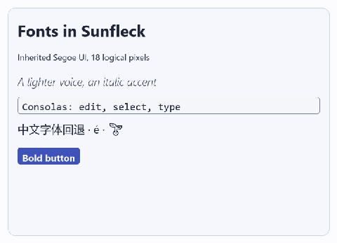
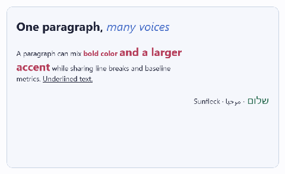

# 字体与 Windows 文字服务

所有视觉节点和组件宿主提供 `FontFamily`、`FontSize`、`FontWeight`、`FontStyle`、`FontStretch`，支持局部值、继承、绑定、清除、样式值层与检查器来源。C ABI、C++、C#、Fleck、编译资源和编辑器补全/F12 使用同一属性契约。

| 属性 | 类型与范围 | 默认值 |
|---|---|---|
| FontFamily | 非空 UTF-8 系统字体族名称，最多 256 字节 | Microsoft YaHei UI |
| FontSize | 有限浮点数，0 < 值 ≤ 4096，96 DPI 逻辑像素 | 14 |
| FontWeight | 枚举，或 1–999 的数值 | Normal（400） |
| FontStyle | Normal / Oblique / Italic | Normal |
| FontStretch | UltraCondensed / ExtraCondensed / Condensed / SemiCondensed / Normal / SemiExpanded / Expanded / ExtraExpanded / UltraExpanded | Normal |

FontWeight 的常用名称包括 Thin、ExtraLight、Light、SemiLight、Normal、Medium、SemiBold、Bold、ExtraBold、Black、ExtraBlack。DirectWrite 根据字体实际可用的字形选择最接近的字重与宽度；声明不同 Stretch 不保证字体提供对应字面。

```xml
<StackPanel FontFamily="Segoe UI" FontSize="18">
  <TextBlock Text="Inherited font"/>
  <TextBlock Text="Heading" FontSize="32" FontWeight="Bold"/>
  <TextBlock Text="Italic" FontStyle="Italic"/>
  <TextBox Text="Editable text" FontFamily="Consolas" FontSize="{Binding EditorSize}"/>
</StackPanel>
```

父节点更新会使继承该属性的后代重新测量。子节点的显式值即使与当前继承值相同，也会截断该属性的继承；清除局部值后恢复当前父值。非法值保留原有效值与绑定。FontSize 支持动画值层，其他字体属性不接受动画覆盖；动画层不会改写绑定源，移除后恢复当前基础值。播放控制见 [属性动画](animation.md)。

```csharp
var text = new Sunfleck.Elements.TextBlock(app) {
    FontFamily = "Consolas", FontSize = 23.5,
    FontWeight = FontWeight.Bold, FontStyle = FontStyle.Italic
};
text.Node.ClearProperty(PropertyTarget.FontSize);
```

C 使用 `UI_PROPERTY_FONT_*` 和类型化 `ui_binding_value`：Family 为 `UI_VALUE_STRING`，Size 为 `UI_VALUE_DOUBLE`，Weight/Style/Stretch 为 `UI_VALUE_ENUM`。C++ 可使用相同属性枚举与 `Node::setPropertyValue`，以及生成的 `elements::TextBlock::FontSizeProperty` 等描述符绑定模型。

Windows 原生窗口与 Windows Headless 使用 DirectWrite 测量、塑形、系统字体回退、换行、字形覆盖率、选区和光标位置。CPU、D3D11 和 Skia D3D12 消费相同灰度抗锯齿字形命令。编辑边界取 DirectWrite 塑形簇与 Windows ICU 字素边界的交集，避免把组合字符、emoji 修饰符或 ZWJ 序列拆开。宿主提交的非法文字簇边界被拒绝，保留旧会话。字号变化同步更新宿主几何及 Windows IME 候选位置。

Windows 构建需要含 `icu.h`、`icu.lib` 的 Windows SDK；当前验证 SDK 为 10.0.26100.0。运行依赖系统 DirectWrite 与 ICU C API（Windows 10 1903 或更新版本）；尚未在最低版本系统实机验收。框架不分发系统字体，缺少指定字体族时使用 DirectWrite 字体回退。

当前批次边界：

- 应用字体注册与 Run/Span 使用同一文字服务。彩色字体当前走单色字形覆盖路径。
- Windows TextBlock Auto 高度已使用可用宽度测量整段文字，包含 Margin、Border 内缩和滚动条宽度；保留原有 48 逻辑像素最小自动高度。显式 Height 与 Min/Max 继续优先。
- DocumentView 和 Dock 使用同一文字服务；DocumentView 的粗体、斜体、代码角色可覆盖对应字体属性。
- DocumentView 字体缓存跟随有效字体与字体资源版本失效。Windows 普通段落、标题、代码块和表格单元格均使用整段塑形与文字簇命中；不宣称完整 FlowDocument 语义。
- Linux/Web 的 FreeType 后端支持有效字号、行高和 Run/Span 的字号及前景色。Linux 检测到 HarfBuzz 后，与 Web 一样使用塑形结果的字形索引、advance 和偏移绘制。Linux 与 Web 分别使用可选 FriBidi 和内置 SheenBidi 解析混排方向。

完整示例：[字体示例](../snippets/fleck/fonts.fleck)。

## Windows 原生编辑

TextBox、TextArea 和 PasswordBox 的点击、拖选、Shift 扩选、删除、复制/剪切/粘贴均使用同一排版结果和文字簇边界。PasswordBox 禁止复制和剪切密码。左右方向键沿视觉位置移动，上下方向键寻找相邻行的最近位置；Home/End 移至当前排版行的逻辑起止，Ctrl+Home/End 移至文档起止。

光标同时保存文本索引与前后边缘亲和性，在双向文字交界或软换行处区分同一索引的两个位置。绘制、宿主选区与 Windows IME 使用这份几何；IME 组合期间方向键交给输入法处理。编辑视口保留小数原点和宽度，滚动与光标仅在最终像素边界取整，避免 DPI 缩放后提前取整改变换行。

在双向文字交界处，点击共用同一屏幕坐标的两个字符边缘时，按鼠标所在字符的一侧定位。Shift 扩选与收起选区保存锚点的亲和性。TextArea 连续 Up/Down 或 Shift+Up/Down 会保持水平目标位置，经过较短的一行后能在下一条长行恢复原列。水平移动、鼠标定位、编辑和宿主选区更新会重置目标位置。

原生编辑测试覆盖 CPU、D3D11、Skia/WARP、100%/150%/200% DPI、部分选区、组合字符与 emoji、双向光标及自动换行。实际输入法候选窗口和最低 Windows 版本仍需对应机器验收；自动发送组合消息不能替代人工输入法验收。



[统一属性系统](property-system.md) · [Border](border.md) · [渲染依赖](rendering.md)

## 文字外观与排版属性

Windows 原生与 Headless 共用以下 DirectWrite 属性。声明可用于全部视觉节点和组件宿主；容器上的继承属性作用于后代。单行控件始终不换行，编辑器不省略文本。

| 属性 | 可用值 | 默认值 | 继承 |
|---|---|---|---|
| Foreground | ARGB Color；Fleck 为 #RRGGBB / #AARRGGBB | 未设置时使用控件主题色；属性描述默认黑色 | 是 |
| TextAlignment | Left / Center / Right / Justify | Left | 是 |
| TextWrapping | NoWrap / Wrap | Wrap | 否 |
| TextTrimming | None / CharacterEllipsis / WordEllipsis | None；未设置时保留旧单行标签省略策略 | 否 |
| LineHeight | 0–4096 的有限浮点逻辑像素，0 为字体自动行高 | 0 | 是 |
| TextDecorations | None / Underline / Strikethrough / Underline,Strikethrough | None | 是 |
| FlowDirection | LeftToRight / RightToLeft | LeftToRight | 是 |

Left/Right 是绝对水平对齐；FlowDirection 控制段落文字方向，当前不镜像布局容器。LineHeight 同时影响绘制、换行、光标与选区。Foreground 保留透明度；编辑选区继续使用主题选中文字颜色。Foreground 和 LineHeight 可使用动画值层，尚不等于已提供通用动画调度。

```xml
<StackPanel Foreground="#FF224466" FontSize="18">
  <TextBlock Text="Centered text" TextAlignment="Center" LineHeight="30"/>
  <TextBlock Text="Long text with explicit ellipsis" Width="180"
             TextWrapping="NoWrap" TextTrimming="WordEllipsis"/>
  <TextBlock Text="Underlined" TextDecorations="Underline"/>
  <TextArea Text="Editable paragraph" TextWrapping="Wrap" LineHeight="28"/>
</StackPanel>
```

C# 使用同名属性及 TextAlignment、TextWrapping、TextTrimming、TextDecorations、FlowDirection 枚举。组合装饰使用位或。C ABI 使用 UI_PROPERTY_FOREGROUND（UI_VALUE_COLOR）、UI_PROPERTY_LINE_HEIGHT（UI_VALUE_DOUBLE），其余五项为 UI_VALUE_ENUM。C/C++ 生成描述符、Fleck 资源和编辑器同步。Linux/Web 的 FreeType 测量、绘制和编辑几何共享按字符换行及左、中、右对齐。启用双向解析后，按行保存混排视觉位置与光标边界。仍待扩大跨脚本塑形、语言断行、字体回退和混排选区覆盖。两端对齐、删节和文字装饰仍待追齐。

## 应用字体注册（Windows）

`ui_app_register_font` / `App::registerFont` / `App.RegisterFont` 将 TTF、OTF 或 TTC 字节复制到当前 App 的字体集合，返回应用范围内的字体 ID。通过 `ui_app_font_family_count` 与 `ui_app_font_family`、C++ `fontFamilies` 或 C# `FontFamilies` 读取文件实际提供的字体族，再用既有 FontFamily 属性或 Fleck 声明选择。字体不安装到系统，不影响其他 App。

```csharp
ulong id = app.RegisterFont(File.ReadAllBytes("fonts/NotoSansMono.ttf"));
string family = app.FontFamilies(id)[0];
var text = new Sunfleck.Elements.TextBlock(app) { FontFamily = family, FontSize = 20 };
// 用完后恢复系统字体解析；也可由 App 销毁统一释放。
app.UnregisterFont(id);
```

注册与注销要求应用 UI 线程，绘制期间拒绝修改。非法文件保留原字体集合，C ABI 的输出 ID 也不改变。单文件上限 64 MiB，单 App 最多 32 项、总计 128 MiB；每项可包含多个字面/字体族。字号、排版和命中缓存随集合变化失效。注销后当前视图重新排版，旧布局缓存释放其字体引用。未在应用集合找到 FontFamily 时继续使用系统解析；完整的应用字体回退链和 Fleck 资源字典字体对象仍未提供。Linux/Web 当前明确返回 Unsupported，待 M9 追齐。

## Run / Span 行内内容

TextBlock 内可嵌套 Run 和 Span。Run 提供可绑定的 Text；Span 把 FontFamily/Size/Weight/Style/Stretch、Foreground 和 TextDecorations 继承给后代。Windows 将所有行内内容交给同一个 DirectWrite 段落排版，字号变化、换行、基线及 Auto 高度保持一致。段落对齐、换行、行高和阅读方向以 TextBlock 为准。

```xml
<TextBlock FontSize="18">
  <Run Text="Normal "/>
  <Span Foreground="#FFB43B58" FontWeight="Bold">
    <Run Text="bold "/>
    <Run Text="larger" FontSize="28"/>
  </Span>
  <Run Text=" and underlined" TextDecorations="Underline"/>
</TextBlock>
```

C 使用 UI_RUN/UI_SPAN 与 ui_node_append，C++ 使用 elements::Run / elements::Span，C# 使用 Sunfleck.Elements.Run / Span 和 Node.Append。TextBlock/Span 的 Text 声明若同时存在，作为子行内内容之前的文字；读取 Node.Text 得到合并文字，写入该节点的 Text 仅替换它自己的文字部分。Run 的 Text 绑定、字体绑定和清除局部属性沿用统一通路。Hidden 行内内容保留排版但透明绘制，Collapsed 从文字序列中移除。

Run/Span 只能作为 TextBlock 或 Span 的子节点，不能作为窗口根或普通 Panel 的子节点。它们没有独立视觉布局槽位；Width、Margin 等通用节点属性不参与段落几何。当前使用显式 Run.Text 属性，不支持 XML 裸文字混排、LineBreak 标签、TextBlock.Inlines 属性元素或行内交互控件。编译页面必须与当前运行时匹配，参见 [SDK 迁移](../../core/docs/sdk-migration.md)。

完整示例：[行内文字](../snippets/fleck/inlines.fleck)。


